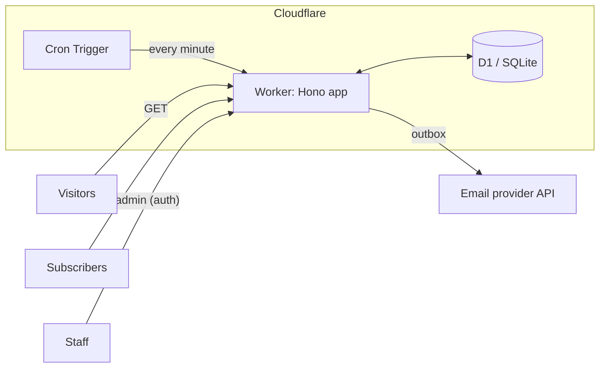

# Option: serverless rewrite (free hosting)

**Status:** chosen direction for the new version. Backwards compatibility with v2
is not required, so the migration notes below are optional.

The goal is a status page **with an admin UI** that can be hosted **for free**, on
infrastructure separate from the services it reports on, with as little server
surface to attack as possible.

> Free-tier limits change often. Every number below needs checking against the
> provider's current terms before we commit to them.

> **First version:** the Worker (admin only), D1, R2 (the public site as static files),
> a Cron Trigger and Access. Email and Turnstile come in later, together with
> subscriptions. See [plan.md](plan.md).

## Why serverless suits a status page

- **Traffic arrives in bursts.** Visits spike exactly when something is broken. An
  Worker scales to them automatically and for free; a small VM or shared host may not.
- **Writes are rare.** A few incidents a month, so the free database quotas are far
  more than we need.
- **Fewer moving parts to maintain.** No server to patch, no PHP version to track,
  and no `config.php` sitting in a web root.
- **Independence.** The page stays up when the monitored infrastructure goes down.

## Proposed stack (Cloudflare)

| Concern | Choice | Notes |
| --- | --- | --- |
| Runtime | **Cloudflare Workers**, TypeScript | One Worker serves the public pages, API, admin UI, subscriber flows and feeds. |
| Web framework | **Hono** | Small, standards-based (Fetch API). Also runs on Node, Bun and Deno, which keeps us portable. |
| Database | **D1** (SQLite) | Plain SQL with versioned D1 migrations. The queries are standard SQLite, so a Node build could use a SQLite file. |
| Static assets | Workers static assets | CSS, small JS and flags; no CDN dependencies. |
| Background work | **Cron Trigger** (for example every minute) | Processes a notification outbox table in D1. No dependency on a paid queue product. |
| Email | External provider API (Resend, Brevo, SMTP relay, …) behind a `Mailer` interface | Workers' built-in email sending only reaches verified addresses, so it cannot email subscribers. |
| Bot protection | **Turnstile** | Free, and more privacy-friendly than reCAPTCHA. |
| Admin auth | See [Admin authentication](#admin-authentication) | |
| Rendering | Server-rendered HTML (Hono JSX) plus small client-side JS | Fast first render with no frontend build. JavaScript is allowed but optional. |

### Request handling

- **The public site never runs the Worker.** Every request to a Worker counts against
  the free plan's daily request limit, and a status page gets most of its traffic
  exactly when something is broken: a few thousand visitors with the page open, each
  refreshing every minute, would use up the day's quota within an hour. So the public
  pages, the JSON API and the Atom feed are static files in an R2 bucket, served
  from Cloudflare's cache on the public hostname. Traffic to them is free and
  unlimited, and they stay up even if the Worker or D1 has trouble.
- **Writes publish.** An admin write queues the pages it affects (`publish_queue`)
  and renders the first few in the same request. A Cron Trigger every minute
  renders the rest, re-renders incidents that started or ended on their own
  (maintenance windows), and re-renders everything after a deploy. Edges keep pages
  for 30 seconds (`s-maxage=30`), so a change is visible within about half a minute.
- **Admin and subscriber routes** are never cached.
- **Notifications:** posting an incident writes rows to an `outbox` table in the
  same transaction. The cron handler claims rows atomically
  (`UPDATE … SET claimed_at … RETURNING`), sends them, and retries with a bounded
  backoff. This fixes M3 and M4 from the v2 security review (kept private) by design.

## Admin authentication

Choose one:

1. **Cloudflare Access in front of `/admin`.**
   - **Pros:** no login, password or reset code in the app at all, since Access
     handles SSO, one-time codes and MFA. The app only verifies the Access JWT.
     The Zero Trust free plan covers small teams (the user limit needs checking).
     This is the smallest attack surface of the three.
   - **Cons:** tied to Cloudflare; the domain must be on Cloudflare; self-hosters
     need another option.
2. **Built-in passkeys (WebAuthn) with email magic-link recovery.**
   - **Pros:** no passwords to store or hash, and it works on any host.
   - **Cons:** more code to own, and depends on email delivery for recovery.
3. **Built-in passwords.**
   - PBKDF2 through WebCrypto. Argon2 and bcrypt are not native in Workers.
   - **Watch out:** the free plan's per-request **CPU-time limit** is very small
     (milliseconds). A properly expensive password hash may exceed it, which is
     the main argument against this option on the free tier. This needs measuring
     before we decide.

Recommendation: **(1) as the default deployment, (2) as the portable built-in
option.** Legacy staff passwords then do not need to be migrated at all: users sign
in with Access or register a passkey through an emailed link.

## Keeping it portable

Cloudflare is the reference deployment, but the core should not depend on it:

- Only touch platform services through small interfaces: `Db` (the queries in `src/db.ts`),
  `Mailer`, `Cache`, `Scheduler`, `AuthProvider`.
- Ship a **Node adapter plus a Docker image** (SQLite file or Postgres, a cron
  process, built-in auth), for people who want to self-host on a VPS.
- Other serverless targets (Vercel or Netlify functions with Neon or Supabase
  Postgres) then only need a thin adapter.

## Migrating from v2 (optional)

Not a goal. These notes apply only if we decide to build a v2 importer.

| Area | Impact |
| --- | --- |
| **PHP shared hosting** | Dropped. |
| Data migration | **Done:** `scripts/import-v2.mjs` converts a `mysqldump` into SQL for D1 (see the README). HTML-escaped values are unescaped once (B17), and outage end times are derived from the posts that superseded them. Users without shell access would still need a way to get a dump (e.g. phpMyAdmin's export). |
| Staff accounts | Imported without passwords. Each user is invited to sign in with Access or a passkey. Optionally, the legacy `sha256(pass . salt)` hash can be verified once through WebCrypto. |
| Subscribers | Imported with their tokens, so links in emails already sent keep working. |
| Legacy URLs | All of them can be routed by the Worker (`/index.php?do=manage…`, `/api/status.php`, `/telegram_check.php`, `/admin/`) once the domain points at the new deployment. |
| Translations | `.po` files are converted to JSON at build time. The POEditor workflow is kept and system locales are no longer needed. |
| Collations | SQLite compares bytes by default, so the look-alike problem (M5) goes away. |

## Free-tier fit (verify before committing)

| Need | Typical small install | Fits the free tier? |
| --- | --- | --- |
| Page views | Low, with spikes during outages | Yes, within the Workers daily request quota (verify current limit) |
| DB size | Well under 100 MB | Yes |
| DB reads and writes | Low (writes are rare) | Yes |
| Cron | Every 1–5 min | Yes |
| Email | Bursts of N subscribers per incident | **The tightest limit.** Free provider tiers cap daily sends. Large lists need a paid tier or SMTP from the user's own provider. |
| CPU per request | Small | Fine for rendering. **Check the cost of auth hashing** (see above). |

## Trade-offs

- **Language change:** PHP to TypeScript. Existing community PHP contributions don't
  carry over, but TypeScript is widely known.
- **Platform dependence**, reduced by the adapter layer and the Docker target.
- **D1 is SQLite:** single-writer, which is fine at this write volume.
- **Email** is the one feature that can't be guaranteed free at scale.
- **Gain:** the attack surface shrinks a lot. No PHP runtime, no writable web root,
  no installer left on disk, no secrets in a database form, and (with Access) no
  auth code at all.

## Open decisions

1. Cloudflare as the reference platform, or start from another provider?
2. Admin auth: Access + passkeys (recommended), or passwords?
3. Email: provider API only, or also generic SMTP for self-hosters?
