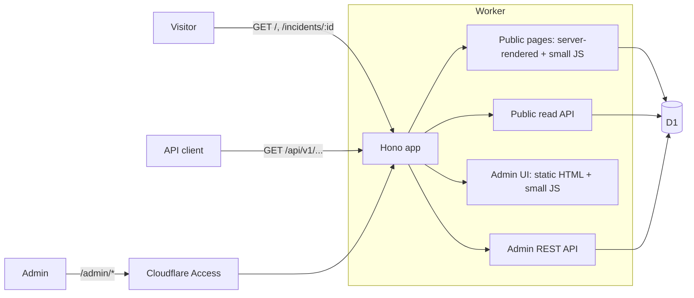
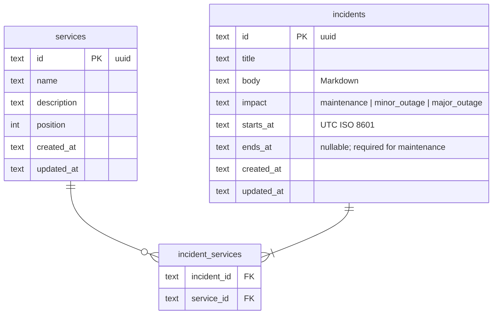
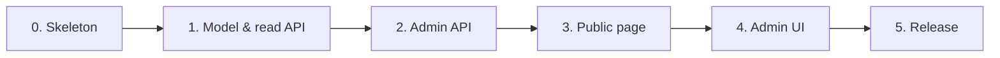

# Rewrite plan

> **Status (2026-11-22):** milestones 0–4 are implemented, plus incident updates. What is left is deploying
> and the release tasks in milestone 5. The README documents the API as built.

**Current goal, kept as simple as possible:**
- a **REST API** for managing and listing incidents (and the services they affect);
- a basic **public status page**;
- a basic **admin UI**.

There are no subscriptions, email, uptime checks, groups or translations in the first
version. Background is in [considerations.md](considerations.md) and
[hosting.md](hosting.md).

**Stack:** TypeScript, Hono, zod, Cloudflare Workers + D1, Cloudflare Access,
Vitest, Wrangler, markdown-it. No ORM (three tables of plain SQL, with Wrangler's D1
migrations), no frontend framework, no CSS framework.

## Architecture

- **One Worker serves everything.** It is the only deployable unit.
- **Auth is Cloudflare Access on `/admin*`.** That one path covers both the admin UI
  and the management API. The app itself has no login code; it only verifies the
  Access JWT on every `/admin` request, as a second check behind Access. Scripts
  can use Access service tokens.
- **The admin UI is a client of the admin REST API.** All writes go through the API,
  so there is a single write path.
- **No caching.** The public page and read API are rendered from D1 on every
  request, so they are always correct: admin writes and maintenance windows that
  start or end on their own both show up immediately. There is no purge, TTL or cron.
  The Worker runs for every request anyway (caching would only save D1 reads, which
  are well within the free quota). The public page refreshes itself by polling
  itself every 60 s and swapping in the new content, without a full page reload.

## Data model

There is one vocabulary: a service's **status** is `operational`, `maintenance`,
`minor_outage` or `major_outage`, and an incident's **impact** is the status it gives
the services it affects. Planned maintenance is an incident with impact
`maintenance`. There is no stored status (no `kind` or `status` column): an
incident's **state** follows from its times, so nothing has to be kept in sync.

**Incident updates** (`incident_updates`: `incident_id`, `status`, `body`, `created_at`)
are status messages posted while an incident runs. `status` is `identified`,
`monitoring`, `update` or `ended`; posting `ended` sets the incident's `ends_at`. Moving a planned end
(overrunning maintenance) is an edit of the incident. The public timeline per incident is
Started (`starts_at` + `body`), the updates, and Ended (`ends_at`), newest first.

**Status rules** (pure functions in `src/status.ts`, unit-tested):
- **State:** `upcoming` while `now < starts_at`; `ended` once `ends_at <= now`;
  otherwise `active`. Resolving an incident means setting `ends_at`.
- **Service status:** the worst impact among the active incidents affecting the
  service, or `operational` if there are none.
- **Overall banner:** the worst service status.
- Every incident affects at least one service. A service can't be deleted while
  incidents refer to it (409), so history is never lost silently.

## REST API (v1)

JSON only. Errors use `application/problem+json` (RFC 9457). Inputs are validated
with zod, and `limit` is capped at 50. Pagination uses an opaque keyset cursor.

### Public (no auth)

| Method | Path | Returns |
| --- | --- | --- |
| GET | `/api/v1/status` | Overall status, every service with its status, active and upcoming incidents |
| GET | `/api/v1/services`, `/api/v1/services/{id}` | Services |
| GET | `/api/v1/incidents?state=upcoming\|active\|ended&limit=&cursor=` | Paginated incidents, newest first (upcoming: soonest first) |
| GET | `/api/v1/incidents/{id}` | One incident, with its `state` and `service_ids` |

### Admin (behind Access)

| Method | Path | Notes |
| --- | --- | --- |
| POST | `/admin/api/v1/services` | Create a service |
| PATCH | `/admin/api/v1/services/{id}` | Update a service |
| DELETE | `/admin/api/v1/services/{id}` | Refused (409) while incidents refer to the service |
| POST | `/admin/api/v1/incidents` | Create an incident or maintenance |
| PATCH | `/admin/api/v1/incidents/{id}` | Update it, including resolving it (`ends_at`) |
| DELETE | `/admin/api/v1/incidents/{id}` | Delete it |

There are no admin `GET` endpoints: they would duplicate the public read API, and
the admin pages read from D1 directly. A `PATCH` is merged with the stored record and
the result is validated as a whole, so the cross-field rules always hold.

**Write requests from browsers:** the management API accepts only
`Content-Type: application/json` and checks `Origin`. Together with the
`SameSite` Access cookie, that removes cross-site request forgery without any
separate CSRF token.

## Milestones

### 0 – Skeleton
- New repository, strict TypeScript, ESLint and Prettier, Vitest with the Workers
  pool, and a CI pipeline (typecheck, lint, test, `npm audit`).
- A Hono app with security headers (strict CSP, HSTS, `nosniff`,
  `frame-ancestors 'none'`) and a problem+json error handler.
- Deploy to a free `*.workers.dev` URL.

### 1 – Data model and public read API
- SQL schema as a D1 migration, plus `seed.sql`.
- The status rules as pure functions, with unit tests.
- The public `GET` endpoints, tested against seeded D1.

### 2 – Admin API
- Access JWT verification middleware for `/admin*`.
- The management endpoints, and the JSON + `Origin` check.
- Tests: unauthenticated requests are refused on every admin route; validation;
  each create/update/delete is reflected in the read API.

### 3 – Public page
- Server-rendered HTML (Hono JSX) and one small CSS file, plus a small script for
  relative times, local time zones and 60 s auto-refresh.
- Contents: the overall banner, services with their status, active incidents,
  upcoming maintenance, and the recent history with a "load more" link; plus a page
  for each incident.
- Incident bodies rendered from Markdown with HTML disabled and a link-scheme
  allowlist.

### 4 – Admin UI
- Server-rendered pages (services list and form, incidents list and form). One plain
  script submits the forms as JSON to the admin API with `fetch`. There is no build
  step for the UI.

### 5 – Release
- A README and a "deploy your own" guide (Cloudflare account, D1, an Access
  application, `wrangler deploy`), and a D1 backup command.
- A quick security pass against the v2 security review (not published; see HANDOFF.md) to make sure none of the
  v2 mistakes came back.

## Later (not now)

Service groups, email subscriptions
(and with them an outbox processed by a Cron Trigger), RSS/Atom, translations,
roles, uptime checks, and a Node/Docker build.
