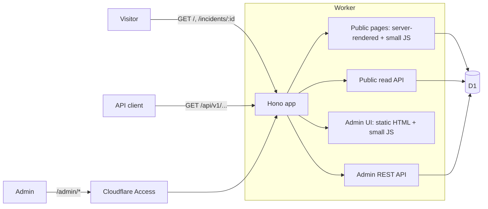
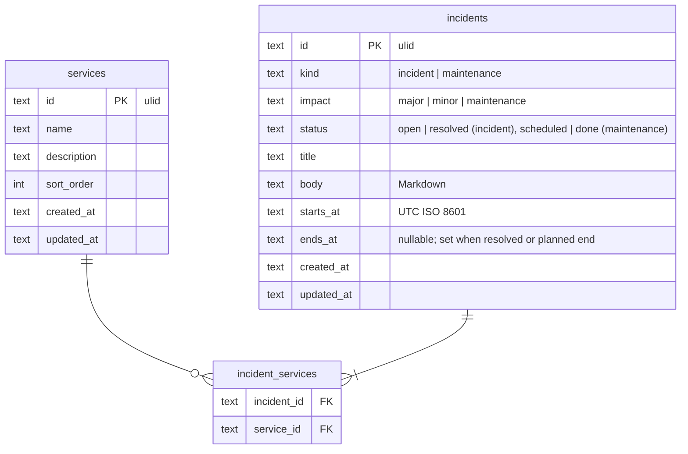
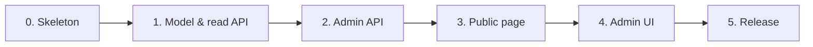

# Rewrite plan (draft)

**Current goal, kept as simple as possible:**
- a **REST API** for managing and listing incidents (and the services they affect);
- a basic **public status page**;
- a basic **admin UI**.

There are no subscriptions, email, uptime checks, groups or translations in the first
version. Background is in [considerations.md](considerations.md) and
[hosting.md](hosting.md).

**Stack:** TypeScript, Hono, Drizzle, zod, Cloudflare Workers + D1, Cloudflare
Access, Vitest, Wrangler. No frontend framework, no CSS framework.

## Architecture

- **One Worker serves everything.** It is the only deployable unit.
- **Auth is Cloudflare Access on `/admin*`.** That one path covers both the admin UI
  and the management API. The app itself has no login code; it only verifies the
  Access JWT on every `/admin` request, as a second check behind Access. Scripts
  can use Access service tokens.
- **The admin UI is a client of the admin REST API.** All writes go through the API,
  so there is a single write path.
- **No caching.** The public page and read API are rendered from D1 on every
  request, so they are always correct: admin writes and maintenance windows that
  start or end on their own both show up immediately. There is no purge, TTL or cron.
  The Worker runs for every request anyway (caching would only save D1 reads, which
  are well within the free quota). The public page refreshes itself by polling
  `GET /api/v1/status` every 60 s and updating the banner and service list, without
  a full page reload.

## Data model

**Status rules** (pure functions, unit-tested):
- **Active incident:** `starts_at <= now`, and either `ends_at` is null or
  `ends_at > now`, and `status` is not `resolved` or `done`.
- **Service status:** the worst impact among the active incidents affecting the
  service, or `operational` if there are none.
- **Overall banner:** the worst service status.
- **Upcoming:** maintenance with `starts_at > now`.

## REST API (v1)

JSON only. Errors use `application/problem+json` (RFC 9457). Inputs are validated
with zod, and `limit` is capped at 50.

### Public (no auth)

| Method | Path | Returns |
| --- | --- | --- |
| GET | `/api/v1/status` | Overall status, plus every service with its current status |
| GET | `/api/v1/services` | Services |
| GET | `/api/v1/incidents?state=active\|upcoming\|past&limit=&cursor=` | Paginated incidents, newest first |
| GET | `/api/v1/incidents/{id}` | One incident with the services it affects |

### Admin (behind Access)

| Method | Path | Notes |
| --- | --- | --- |
| GET | `/admin/api/v1/services` | List services |
| POST | `/admin/api/v1/services` | Create a service |
| PATCH | `/admin/api/v1/services/{id}` | Update a service |
| DELETE | `/admin/api/v1/services/{id}` | Refused (409) while incidents reference the service, so history is never lost silently |
| GET | `/admin/api/v1/incidents` | List incidents, including all states |
| POST | `/admin/api/v1/incidents` | Create an incident or maintenance |
| PATCH | `/admin/api/v1/incidents/{id}` | Update it, including resolving it (`status`, `ends_at`) |
| DELETE | `/admin/api/v1/incidents/{id}` | Delete it |

**Write requests from browsers:** the management API accepts only
`Content-Type: application/json` and checks `Origin`. Together with the
`SameSite` Access cookie, that removes cross-site request forgery without any
separate CSRF token.

## Milestones

### 0 – Skeleton
- New repository, strict TypeScript, ESLint and Prettier, Vitest with the Workers
  pool, and a CI pipeline (typecheck, lint, test, `npm audit`).
- A Hono app with security headers (strict CSP, HSTS, `nosniff`,
  `frame-ancestors 'none'`) and a problem+json error handler.
- Deploy to a free `*.workers.dev` URL.

### 1 – Data model and public read API
- Drizzle schema and migrations, plus a seed script.
- The status rules as pure functions, with unit tests.
- The public `GET` endpoints, tested against seeded D1.

### 2 – Admin API
- Access JWT verification middleware for `/admin*`.
- The management endpoints, and the JSON + `Origin` check.
- Tests: unauthenticated requests are refused on every admin route; validation;
  each create/update/delete is reflected in the read API.

### 3 – Public page
- Server-rendered HTML (Hono JSX) and one small CSS file, plus a small script for
  relative times, local time zones and 60 s auto-refresh from the read API.
- Contents: the overall banner, services with their status, active incidents,
  upcoming maintenance, and the recent history with a "load more" link; plus a page
  for each incident.
- Incident bodies rendered from Markdown with HTML disabled and a link-scheme
  allowlist.

### 4 – Admin UI
- A few static pages (services list and form, incidents list and form) using plain
  JavaScript and `fetch` against the admin API. There is no build step for the UI.

### 5 – Release
- A README and a "deploy your own" guide (Cloudflare account, D1, an Access
  application, `wrangler deploy`), and a D1 backup command.
- A quick security pass against the v2 security review (not published; see HANDOFF.md) to make sure none of the
  v2 mistakes came back.

## Later (not now)

Incident updates (a timeline per incident), service groups, email subscriptions
(and with them an outbox processed by a Cron Trigger), RSS/Atom, translations,
roles, uptime checks, and a Node/Docker build.
