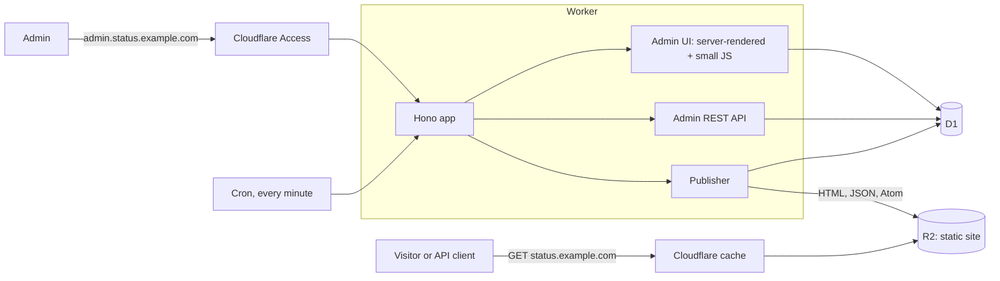
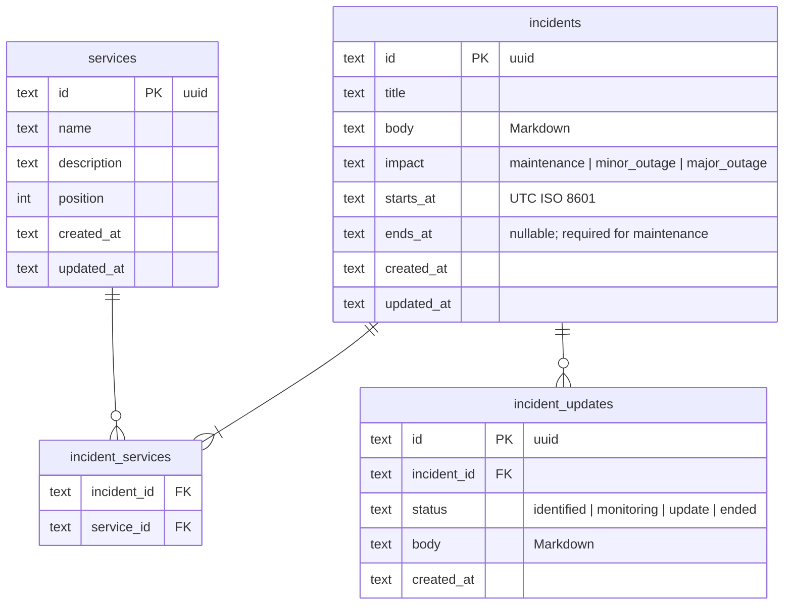
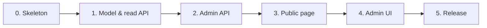

# Rewrite plan

> **Status (2026-11-22):** milestones 0–4 are implemented, plus incident updates, the
> Atom feed and static publishing of the public site. What is left is deploying and the
> release tasks in milestone 5. The README documents the API as built.

**Current goal, kept as simple as possible:**
- a **REST API** for managing and listing incidents (and the services they affect);
- a basic **public status page**;
- a basic **admin UI**.

There are no subscriptions, email, uptime checks, groups or translations in the first
version. Background is in [considerations.md](considerations.md) and
[hosting.md](hosting.md).

**Stack:** TypeScript, Hono, zod, Cloudflare Workers + D1 + R2, Cloudflare Access,
Vitest, Wrangler, markdown-it. No ORM (a few tables of plain SQL, with Wrangler's D1
migrations), no frontend framework, no CSS framework.

## Architecture

- **The public site is static.** Pages, the JSON API and the Atom feed are files in
  R2, served from Cloudflare's cache on the public hostname. Visitors never run the
  Worker, so traffic spikes during an outage don't touch the free plan's daily
  request limit, and the page stays up even if the Worker or D1 has trouble.
- **The Worker is the admin and the publisher**, on its own hostname behind
  Cloudflare Access. Every path needs Access; the app also verifies the Access JWT
  as a second check. Scripts can use Access service tokens. At `/` it previews the
  published files.
- **The admin UI is a client of the admin REST API.** All writes go through the API,
  so there is a single write path.
- **Publishing:** a write queues the pages it affects (`publish_queue`: the home page,
  the incident's page, its month of history) and renders the first few in the same
  request. The cron job renders the rest, re-renders incidents that started or ended
  on their own since its last run, and re-renders everything when the deployed
  version changes. Edges cache pages for 30 s; the public page polls itself every
  60 s.

## Data model

Two small tables support publishing: `publish_queue` (pages waiting to be rendered)
and `site_state` (the deployed version the site was rendered with, and the cron job's
last run).

There is one vocabulary: a service's **status** is `operational`, `maintenance`,
`minor_outage` or `major_outage`, and an incident's **impact** is the status it gives
the services it affects. Planned maintenance is an incident with impact
`maintenance`. There is no stored status (no `kind` or `status` column): an
incident's **state** follows from its times, so nothing has to be kept in sync.

**Incident updates** are status messages posted while an incident runs. Posting
`ended` (message optional) sets the incident's `ends_at` to now; it is refused before
the incident starts. Deleting an outage's only `ended` update reopens it. Moving a
planned end (overrunning maintenance) is an edit of the incident. The public timeline
per incident is, newest first: Ended at `ends_at` (with the `ended` update's message)
or the expected end, the other updates, and Started (`starts_at` + `body`).

**Status rules** (pure functions in `src/status.ts`, unit-tested):
- **State:** `upcoming` while `now < starts_at`; `ended` once `ends_at <= now`;
  otherwise `active`. Resolving an incident means setting `ends_at`.
- **Service status:** the worst impact among the active incidents affecting the
  service, or `operational` if there are none.
- **Overall banner:** the worst service status.
- Every incident affects at least one service. A service can't be deleted while
  incidents refer to it (409), so history is never lost silently.

## REST API (v1)

JSON only. Admin errors use `application/problem+json` (RFC 9457), and inputs are
validated with zod. [openapi.yaml](openapi.yaml) describes every endpoint.

- **Public** (static files, CORS open): `/api/v1/summary` (a summary),
  `/api/v1/services`, `/api/v1/incidents/active`, `/api/v1/incidents/scheduled`,
  `/api/v1/incidents/past[/{YYYY-MM}]` (one month of ended incidents per page, with
  `next` linking to the next older month) and `/api/v1/incidents/{id}`. Pages are by
  month rather than by cursor or page number, so each page is a stable file that
  only changes when that month does.
- **Admin** (behind Access): create, update and delete services and incidents,
  reorder services, post and delete updates, republish the site, and preview
  Markdown. A `PATCH` is merged with the stored record and the result is validated as
  a whole, so the cross-field rules always hold.

**Write requests from browsers:** the management API accepts only
`Content-Type: application/json` and checks `Origin`. Together with the
`SameSite` Access cookie, that removes cross-site request forgery without any
separate CSRF token.

## Milestones

### 0 – Skeleton
- New repository, strict TypeScript, ESLint and Prettier, Vitest with the Workers
  pool, and a CI pipeline (typecheck, lint, test, `npm audit`).
- A Hono app with security headers (strict CSP, HSTS, `nosniff`,
  `frame-ancestors 'none'`) and a problem+json error handler.
- Deploy to a free `*.workers.dev` URL.

### 1 – Data model and public read API
- SQL schema as a D1 migration, plus example data in `fixtures/demo.sql`.
- The status rules as pure functions, with unit tests.
- The public `GET` endpoints, tested against seeded D1.

### 2 – Admin API
- Access JWT verification middleware for `/admin*`.
- The management endpoints, and the JSON + `Origin` check.
- Tests: unauthenticated requests are refused on every admin route; validation;
  each create/update/delete is reflected in the read API.

### 3 – Public page
- Server-rendered HTML (Hono JSX) and one small CSS file, plus a small script for
  relative times, local time zones and 60 s auto-refresh.
- Contents: the overall banner, services with their status, active incidents,
  upcoming maintenance, and the recent history with a "load more" link; plus a page
  for each incident.
- Incident bodies rendered from Markdown with HTML disabled and a link-scheme
  allowlist.

### 4 – Admin UI
- Server-rendered pages (services list and form, incidents list and form). One plain
  script submits the forms as JSON to the admin API with `fetch`. There is no build
  step for the UI.

### 5 – Release
- A README and a "deploy your own" guide (Cloudflare account, D1, an Access
  application, `wrangler deploy`), and a D1 backup command.
- A quick security pass against the v2 security review (kept private) to make sure none of the
  v2 mistakes came back.

## Later (not now)

Service groups, email subscriptions (and with them an outbox processed by the cron
job), live push updates (a Durable Object hub), uptime bars from incident history,
translations, roles, uptime checks, and a Node/Docker build.
