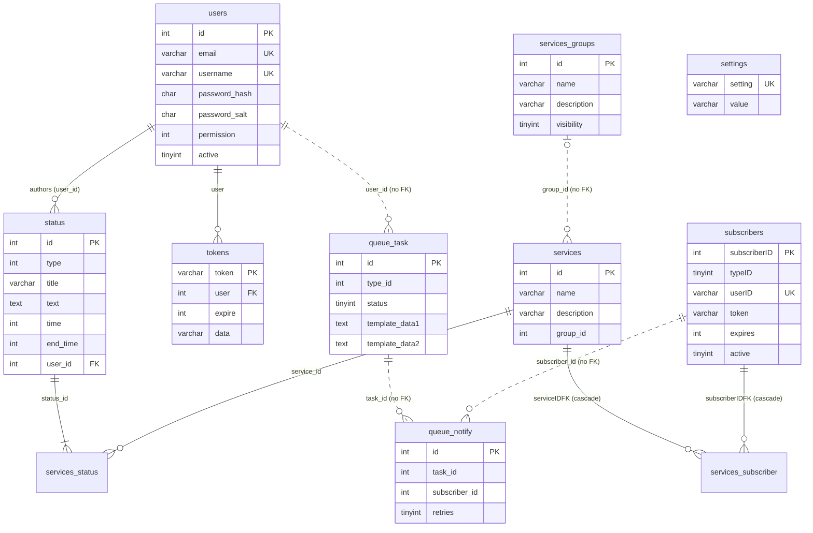

# Data model

Source of truth: `install.sql`. It contains the original `CREATE TABLE`s followed by
later `ALTER`s appended at the bottom; the description below is the **resulting**
schema. There is no migrations table. `settings.dbConfigVersion` holds a version
string (`Version2Beta7`) but nothing reads it.

All timestamps are **Unix epoch seconds in `int(11)`**. Collations are mixed:
`utf8_czech_ci` (3-byte utf8) for the original tables, `utf8mb4_unicode_ci` for
subscriber and group tables.

## Entity relationships

Dashed relationships have no foreign key in the database; they are implied by the code only.

## Tables

### `users` (staff accounts)

| Column | Type | Notes |
| --- | --- | --- |
| `id` | int PK AI | |
| `email` | varchar(60) UNIQUE | login identifier |
| `username` | varchar(50) UNIQUE | shown as incident author |
| `name`, `surname` | varchar(50) | |
| `password_hash` | char(64) | hex `sha256(password . salt)` |
| `password_salt` | char(64) | `uniqid(mt_rand(), true)` |
| `permission` | int, default 0 | rank: 0 super admin, 1 admin, 2 editor |
| `active` | tinyint(1), default 1 | deactivated users cannot log in |

### `tokens` (staff one-time and remember tokens)

| Column | Type | Notes |
| --- | --- | --- |
| `token` | varchar(64) PK | hex `sha256(user_id . uniqid(mt_rand(), true))` |
| `user` | int FK → users.id | |
| `expire` | int | Unix time |
| `data` | varchar(80) | purpose: `remember`, `passwd`, or `email;<new address>` |

Expired tokens are deleted as a side effect whenever any token is deleted.

### `services`

| Column | Type | Notes |
| --- | --- | --- |
| `id` | int PK AI | |
| `name` | varchar(50) | stored HTML-escaped |
| `description` | varchar(200) NOT NULL | stored HTML-escaped; tooltip |
| `group_id` | int NULL | → services_groups.id (no FK) |

### `services_groups`

| Column | Type | Notes |
| --- | --- | --- |
| `id` | int PK AI | |
| `name` | varchar(50) | stored raw |
| `description` | varchar(50) NULL | |
| `visibility` | tinyint | 0 collapsed, 1 expanded, 2 expand on events (unused) |

### `status` (incidents)

The table name is misleading: each row is an **incident**.

| Column | Type | Notes |
| --- | --- | --- |
| `id` | int PK AI | |
| `type` | int | 0–3, see enumerations |
| `title` | varchar(50) | `strip_tags`'d |
| `text` | text | Markdown, `strip_tags`'d except ` ` |
| `time` | int | start |
| `end_time` | int | end; `0` = open-ended (non-maintenance) |
| `user_id` | int FK → users.id | author |

### `services_status` (incident ↔ service)

| Column | Type | Notes |
| --- | --- | --- |
| `id` | int PK AI | |
| `service_id` | int FK → services.id | |
| `status_id` | int FK → status.id | |

### `subscribers`

| Column | Type | Notes |
| --- | --- | --- |
| `subscriberID` | int PK AI | |
| `typeID` | tinyint | 1 Telegram, 2 email |
| `userID` | varchar(200) UNIQUE | Telegram user id, or email address. Unique across both types. |
| `firstname`, `lastname` | varchar(255) NULL | Telegram only |
| `token` | varchar(100) NULL | 64 hex characters; used in manage and unsubscribe links |
| `expires` | int NULL | activation deadline for email (created + 2 h); NULL after activation |
| `active` | tinyint NULL | 1 = active; NULL/0 = pending |
| `create_time`, `update_time` | int NULL | |

### `services_subscriber` (subscriber ↔ service)

| Column | Type | Notes |
| --- | --- | --- |
| `comboID` | int PK AI | |
| `subscriberIDFK` | int FK → subscribers, ON DELETE CASCADE | |
| `serviceIDFK` | int FK → services, ON DELETE CASCADE | |
| | UNIQUE (`subscriberIDFK`, `serviceIDFK`) | |

### `queue_task`

| Column | Type | Notes |
| --- | --- | --- |
| `id` | int PK AI | |
| `type_id` | int | 1 Telegram, 2 email |
| `status` | tinyint | 1 populating, 2 ready, 3 processing, 4 completed, 5 failed (only 1 and 2 are used) |
| `template_data1` | text NULL | email subject |
| `template_data2` | text NULL | email HTML body, or Telegram text |
| `created_time`, `completed_time` | int | `completed_time` is never set |
| `num_errors` | int NULL | never set |
| `user_id` | int | staff user who posted the incident |

### `queue_notify`

| Column | Type | Notes |
| --- | --- | --- |
| `id` | int PK AI | |
| `task_id` | int | → queue_task.id (no FK) |
| `status` | tinyint | always inserted as 1 |
| `subscriber_id` | int | → subscribers.subscriberID (no FK) |
| `retries` | tinyint NULL | incremented on each failure, no limit |

### `settings`

| Column | Type | Notes |
| --- | --- | --- |
| `setting` | varchar(255) UNIQUE | key |
| `value` | varchar(255) | always a string; booleans are `"yes"` / `"no"`; text values are stored **HTML-escaped** |

A missing key reads back as the **string `"null"`**.

## Settings keys

| Key | Type | Set by | Used for |
| --- | --- | --- | --- |
| `name` | text (escaped) | install, options | site name (`NAME`) |
| `title` | text (escaped) | install | navbar heading (`TITLE`) |
| `url` | URL (raw) | install | base URL for every link and asset (`WEB_URL`) |
| `mailer` | text (escaped) | install | From name |
| `mailer_email` | email (escaped) | install | From address |
| `dbConfigVersion` | string | install | unused |
| `notifyUpdates` | yes/no | options | unused (update check commented out) |
| `subscribe_email` | yes/no | options | enable email subscriptions |
| `subscribe_telegram` | yes/no | options | enable Telegram subscriptions |
| `tg_bot_api_token` | secret | options | Telegram bot token (sending and login verification) |
| `tg_bot_username` | text | options | Telegram login widget |
| `php_mailer` | yes/no | options | use PHPMailer instead of `mail()` |
| `php_mailer_path` | filesystem path | options | directory to `require_once` PHPMailer from |
| `php_mailer_smtp` | yes/no | options | use SMTP |
| `php_mailer_host`, `php_mailer_port` | text | options | SMTP server |
| `php_mailer_secure` | yes/no | options | passed as `SMTPSecure` (a boolean, although PHPMailer expects `'tls'`/`'ssl'`) |
| `php_mailer_user`, `php_mailer_pass` | secret | options | SMTP auth (stored in plaintext) |
| `cron_server_ip` | IP | options | allowed IP for `?task=cron`; empty = process on `?sent=true` |
| `google_recaptcha` | yes/no | options | reCAPTCHA on email sign-up |
| `google_recaptcha_sitekey`, `google_recaptcha_secret` | text / secret | options | reCAPTCHA |

## `config.php` constants

| Constant | Notes |
| --- | --- |
| DB host / user / password / database | hard-coded into `new mysqli(...)` |
| `POLICY_NAME`, `ADDRESS`, `POLICY_MAIL`, `POLICY_PHONE`, `WHO_WE_ARE` | privacy policy page |
| `POLICY_URL` | footer link; defaults to `<url>/policy.php` |
| `INSTALL_OVERRIDE` | `false`; the installer defines `true` itself |
| `DEFAULT_LANGUAGE` | `en_GB` |
| `CUSTOM_LOGO_URL` | empty = bundled logo |
| `COPYRIGHT_TEXT` | appended to the footer |

## Enumerations

Defined as translated PHP arrays in `template.php` (indexes are the stored values):

| Name | Values |
| --- | --- |
| Status / incident type (`$statuses`) | 0 Major outage, 1 Minor outage, 2 Planned maintenance, 3 Operational |
| CSS class (`$classes`) | danger, warning, primary, success |
| Icon (`$icons`) | fa-times, fa-exclamation, fa-info, fa-check |
| Banner "some" (`$some`) | 0–2 only ("Some systems are experiencing …") |
| Banner "all" (`$all`) | 0–3 (3 = "All systems operational") |
| Rank (`$permissions`) | 0 Super admin, 1 Admin, 2 Editor |
| Group visibility (`$visibility`) | 0 Collapsed, 1 Expanded, 2 Expand on events |
| Subscriber type | 1 Telegram, 2 Email |
| Queue task type | 1 notify_telegram, 2 notify_email |
| Queue task status | 1 populating, 2 ready, 3 processing, 4 completed, 5 failed |
