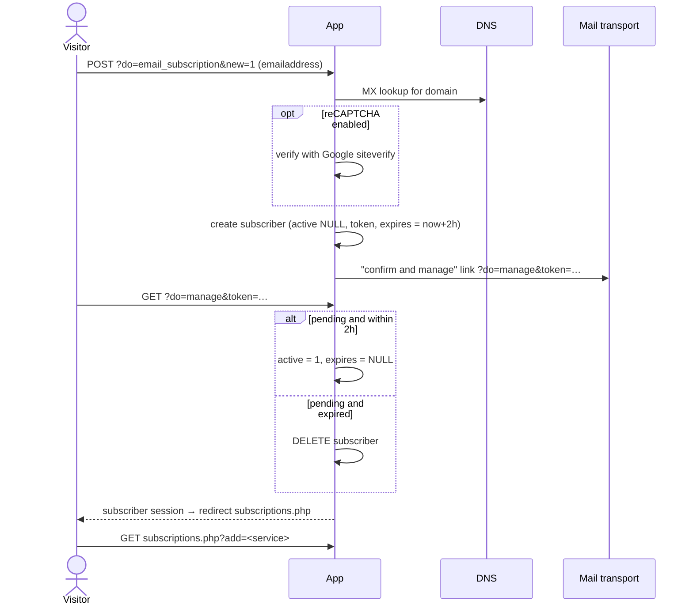
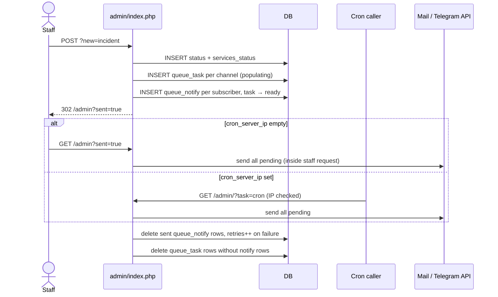

# Features – detailed behaviour

Numbers in parentheses refer to the enumerations in
[data-model.md](data-model.md#enumerations).

## 1. Status model

### Status / incident types

There is a single 4-value scale used both for incident types and service status:

| Value | Label | Bootstrap class | Icon |
| --- | --- | --- | --- |
| 0 | Major outage | `danger` | `fa-times` |
| 1 | Minor outage | `warning` | `fa-exclamation` |
| 2 | Planned maintenance | `primary` | `fa-info` |
| 3 | Operational | `success` | `fa-check` |

Lower is worse. "Operational" is also an incident type: posting an "Operational"
incident is how staff mark a service as recovered.

### Current status of a service (`Constellation::render_status`)

For each service, ordered by group name and then service name:

- Find the **most recent incident** (by `status.time DESC`) linked to the service where
  `time <= now` and (`end_time >= now` or `end_time = 0`).
- The service status is that incident's `type`. If there is none, it is **3 (Operational)**.

So a non-maintenance incident (`end_time = 0`) stays in effect until a newer
incident for the same service replaces it. A maintenance incident only applies
inside its `[time, end_time]` window, after which the service falls back to an
older open incident or to Operational.

If no services exist, a placeholder "No services" entry is rendered.

### Overall banner (`Service::current_status`)

- `worst` = the minimum status across all services.
- If **every** service has the worst status, show the "all" message for that level
  (for example "Our systems are experiencing minor outages", or "All systems
  operational" when everything is 3).
- Otherwise show the "some" message ("Some systems are experiencing …").

### Service list rendering (`Service::render`)

- Services without a group are each rendered as their own `<ul>`.
- Grouped services are rendered under a group header `<li>`. The header shows a
  status badge, which is the status of the **first service rendered in that group**
  (alphabetically), not the worst status in the group. See known issues.
- A service description is shown as a tooltip (`?` icon).
- Group `visibility` (Collapsed / Expanded / Expand on events) is **not used** on the
  public page.

## 2. Incidents

### Data

An incident (table `status`) has a type, title (≤ 50 characters), text (Markdown),
start `time`, `end_time` (0 = open-ended), and author `user_id`. It is linked to one
or more services through `services_status`.

### Creating (`Incident::add`, admin dashboard form)

- Any logged-in staff user can create incidents (there is no rank check).
- Input handling:
  - `title`: `strip_tags`; required; at most 50 characters.
  - `text`: `strip_tags($text, ' ')`. The intended "text required" check
    actually re-checks the title (bug).
  - `services[]`: at least one.
  - Type 2 (maintenance) requires `time` and `end_time`. The JavaScript date pickers
    send ISO strings in `time_js` / `end_time_js`, which take precedence. Values are
    parsed with `strtotime`, and the start must be before the end.
  - Other types: `time = now()`, `end_time = 0`.
- After insert, a `Notification` is created for the impacted services and
  `notify_subscribers()` fills the queue (see §6).
- Redirects to `/admin?sent=true`, which triggers queue processing when no cron IP
  is configured.

### Deleting (`Incident::delete`, `GET /admin/?delete=<id>`)

- Rank ≤ 1 can delete any incident. Editors (rank 2) can only delete incidents where
  `user_id` = themselves.
- Deletes the `services_status` links, then the incident.
- Deleting a **service** also deletes every incident whose only linked service was
  that one.

### Timeline (`Constellation::get_incidents` / `render_incidents`)

- **Planned / ongoing** (`future = true`): incidents with `time >= now AND end_time >= now`,
  or `time <= now AND end_time >= now`. In practice this means maintenance windows
  that have not ended yet. Shown under the "Planned maintenance" heading.
- **Past** (`future = false`): `time <= now AND end_time <= now`. This covers all
  open-ended incidents (`end_time = 0`) and finished maintenance. Shown under
  "Past incidents", or "No incidents" when empty.
- Ordered by `time DESC`, 5 per page. The page is anchored to a `timestamp`
  parameter so pagination stays stable while new incidents are posted.
  `offset` / `timestamp` go in the query string, and "Back" / "Load more" links work
  without JavaScript.
- Each incident renders as a panel with the type colour and icon, title, relative
  time (`timeago`), Markdown body (Parsedown with line breaks enabled), impacted
  service badges, and "Ending/Ended: <end time>" when an end time exists. Admin view
  adds a delete icon for incidents the user may delete.
- `render_incidents()` ignores its `$offset`/`$limit` arguments and reads `$_GET`
  directly.

## 3. Services and service groups (admin "Services & Users")

| Action | Who | Notes |
| --- | --- | --- |
| Add / edit service | rank ≤ 1 | name required, ≤ 50 characters; description; optional group. Name and description are stored **HTML-escaped**. |
| Delete service | rank ≤ 1 | `GET ?do=settings&type=service&delete=<id>`. Cascades: incidents linked only to this service are deleted; links are removed. |
| Add / edit group | rank ≤ 1 | name required, ≤ 50 characters; description (form allows 100, column is 50); visibility 0/1/2. Stored **raw** (not escaped). |
| Delete group | rank ≤ 1 | `GET ?do=settings&type=groups&delete=<id>`. Services in the group become ungrouped. |

The settings page lists services (with group), groups (with service count and
visibility label) and users.

## 4. Staff users and authentication

### Ranks

0 = Super admin, 1 = Admin, 2 = Editor. Permission checks are scattered `if`
statements; the full matrix:

| Capability | Super admin (0) | Admin (1) | Editor (2) |
| --- | --- | --- | --- |
| Post incident | ✔ | ✔ | ✔ |
| Delete any incident | ✔ | ✔ | own only |
| Manage services and groups | ✔ | ✔ | ✘ |
| Create users | ✔ | ✘ | ✘ |
| Change another user's role | ✔ | ✘ | ✘ |
| Activate/deactivate users | lower rank only, not self | lower rank only, not self | ✘ |
| Edit another user's name, username, email | ✔ (email changes directly, no confirmation) | ✘ | ✘ |
| Edit own name, username, email, password | ✔ | ✔ | ✔ |
| Options page | ✔ | ✔ (no check) | ✔ (no check) |

### Login (`User::login`)

- Email + password. Error messages do not reveal which field was wrong.
  Deactivated accounts get a specific "disabled" message.
- Password verification: `sha256(password . salt)` compared in SQL. The salt is
  `uniqid(mt_rand(), true)`, stored per user.
- On success: `$_SESSION['user'] = id`. The session ID is not regenerated.
- **Remember me**: creates a `tokens` row (`data = 'remember'`, expiry about 356 days)
  and sets cookies `token` and `user` (user id). On a later visit without a session,
  `User::restore_session()` validates the token, rotates it (deletes the old one and
  issues a new one) and restores the session. An invalid token clears the cookies.
- There is no rate limiting, lockout or 2FA.

### Logout

Clears the session, deletes the remember token and cookies, and redirects to `/admin`.

### Password reset (`?do=lost-password`)

1. The user submits an email. A `tokens` row is created (`data = 'passwd'`, 24 h) and
   a link `admin/?do=lost-password&id=<id>&token=<token>` is emailed. The response is
   the same whether or not the email exists.
2. The link shows a form with a new password and confirmation. On submit the token is
   validated, the password is rehashed with the **existing salt**, all remember tokens
   are deleted, and the token is deleted.

### Change own password

Requires the old password. Rehashes with the existing salt, deletes all remember
tokens, and logs out.

### Change email

- Super admin editing another user: updates directly.
- Otherwise: emails a confirmation link (`?do=change-email&id=&token=`) to the **new**
  address, and the link applies the change. **This flow is broken** (see known
  issues), so in practice email changes do not work for non-super-admins.

### Create user (super admin, or the installer)

- Name, surname, username, email and password are required, plus a role. Length
  limits match the column sizes.
- Sends the new user an email **containing the plaintext password**.

### Profile page

Shows a Gravatar, then name, username, role and email (editable depending on rank),
the password change form (own profile only), and the activate/deactivate button.

## 5. Subscriptions (public)

Enabled separately per channel through the `subscribe_email` / `subscribe_telegram`
options. The public navbar shows a "Subscribe" dropdown when either is enabled.

### Email

1. **Sign up** (`index.php?do=email_subscription&new=1`): the visitor enters an email.
   - The email domain must have an **MX record** (`checkdnsrr`). IDN domains are
     converted to punycode first.
   - Optional **Google reCAPTCHA v2**, verified server-side.
   - The form says that subscribing means agreeing to the privacy policy.
2. **Outcomes:**
   - New address: create subscriber (`active = NULL`, 64-hex `token`,
     `expires = now + 2h`) and email a "confirm and manage" link
     `index.php?do=manage&token=<token>`.
   - Existing, inactive: resend the link and clear `expires`. Because `activate()`
     sets `expires = NULL`, this resend path can break activation; see known issues.
   - Existing, active: email a "manage your subscription" link.
   - In all cases the page shows "Thank you for subscribing".
3. **Activate / manage** (`?do=manage&token=`):
   - Unknown token: warning.
   - Inactive subscriber within the 2 h window: set `active = 1` and clear `expires`.
     Outside the window: **delete** the subscriber and show a warning.
   - Active: log the subscriber in (session) and redirect to `subscriptions.php`.
4. **Unsubscribe** (`?do=unsubscribe&type=<1|2>&token=`): delete the subscriber and
   their links, then show a confirmation.

### Telegram

1. When enabled, the Telegram Login Widget is embedded in the navbar. Its auth
   callback is `telegram_check.php`.
2. `telegram_check.php` verifies the widget payload: HMAC-SHA256 over the sorted
   `key=value` lines with key `sha256(bot_token)`, and `auth_date` no older than 24 h.
   It stores the payload as JSON in the `tg_user` cookie.
3. Finds or creates a subscriber with `typeID = 1`, `userID = <telegram id>`, first
   and last name, active immediately. Logs in (session) and redirects to
   `subscriptions.php`.

### Managing services (`subscriptions.php`)

- Requires a subscriber session (`$_SESSION['subscriber_valid']`).
- Lists the services followed (click to remove: `?remove=<service id>`) and the
  services not followed (click to add: `?add=<service id>`).
- Shows a "Cancel subscription" button that links to the unsubscribe URL with the
  subscriber's token.
- Subscriber logout: `index.php?subscriber_logout=1`.

## 6. Notifications and queue

### Enqueueing (`Notification::notify_subscribers`, on incident creation)

1. Collect the impacted service IDs and names.
2. Select distinct subscribers of those services. If there are none, stop.
3. For each enabled channel, create a `queue_task` (status `populating`) holding
   the rendered template:
   - Email (`type_id = 2`): `template_data1` = subject
     (`"Status update from - <NAME> [ <status label> ]"`), `template_data2` = HTML body
     from `libs/templates/email_status_update.html`. Placeholders are filled except
     `%token%`. The comment is the Markdown-rendered incident text.
   - Telegram (`type_id = 1`): `template_data2` = translated message with the service
     list, status, title, text and a "View online" link. `#s` is a placeholder for
     the subscriber's first name.
4. For each active subscriber, add a `queue_notify` row (status 1, retries 0) to the
   matching task, then mark the task `ready` (2).

Templates are rendered in the **posting admin's locale**.

### Processing (`Queue::process_queue`)

- Triggers:
  - With **no cron IP configured**: `GET /admin?sent=true` (the redirect after posting
    an incident). It runs inside the admin's request, before authentication.
  - With a cron IP: `GET /admin/?task=cron` from that IP. Calls from other IPs are
    logged to syslog and ignored.
  - `GET /admin/?tasks` from a logged-in dashboard request.
- For every `queue_notify` row with status ≠ 2 whose subscriber is active, load its
  task (if the task status is `ready`):
  - Telegram: replace `#s` with the first name, then call
    `api.telegram.org/bot<token>/sendMessage` with HTML parse mode.
  - Email: replace `%token%` with the subscriber's token, then send through `Mailer`.
  - Success: delete the `queue_notify` row. Failure: increment `retries`. There is
    **no maximum**, so a failing row is retried on every run indefinitely.
- Afterwards, delete every `queue_task` with no remaining `queue_notify` rows.
- No rate limiting. Telegram's limit of about 30 messages per second is a TODO.

### Mail transport (`Mailer::send_mail`)

- **PHPMailer** when `php_mailer = yes`. PHPMailer is not bundled: the code
  `require_once`s `Exception.php`, `PHPMailer.php` and optionally `SMTP.php` from the
  admin-configured `php_mailer_path`. SMTP options: host, port, secure flag, user and
  password.
- Otherwise PHP **`mail()`** with hand-built headers. This path always returns success.
- HTML mail gets a generated plain-text alternative.
- IDN domains in the recipient are converted to punycode.
- Staff emails (account created, password reset, email change) **always** use
  `mail()` directly, bypassing `Mailer`.

## 7. Options (admin `?do=options`)

A single form that saves every key below on submit (each save is a delete followed
by an insert):

- Site name (`name`)
- Update notification toggle (`notifyUpdates`; has no effect because the update check
  is commented out)
- Email subscription and Telegram subscription toggles
- Telegram bot API token and bot username
- PHPMailer toggle, SMTP toggle, secure toggle, library path, host, port, user, password
- Cron server IP
- reCAPTCHA toggle, site key, secret

The site title, URL and mailer name/address are set at install time and cannot be
edited in the UI.

## 8. JSON API

- `GET /api/status.php`: all services with status.
- `GET /api/status.php?id=<id>`: one service (broken; see known issues).
- `GET /api/incidents.php?future=&offset=&limit=&timestamp=`: incidents.

There is no authentication and no rate limiting.

## 9. Installer

Triggered when `config.php` is missing (`index.php` includes `install.php`).

1. Locale negotiation for the installer UI.
2. **Prerequisite checks:** PHP version (it checks ≥ 5.4.0, which is outdated),
   `mysqlnd` present, web root writable.
3. **Form:** site name, URL, title; mailer name and email; DB host, database, user,
   password; privacy-policy name, address, email, phone, "who we are", optional
   external policy URL; first user (name, surname, username, email, password →
   rank 0).
4. **On submit:**
   1. Connect to the DB and validate the URL and required fields.
   2. Run `install.sql`, split naively on `;`.
   3. Create the super admin (`INSTALL_OVERRIDE = true` bypasses the rank check). This
      sends the welcome email with the plaintext password.
   4. Insert the settings rows (name, title, url, mailer, mailer_email, plus defaults
      for every option and `dbConfigVersion = Version2Beta7`).
   5. Write `config.php` from the template, with DB values and policy values
      HTML-escaped.
   6. Generate `.htaccess` (Apache) or `web.config` (otherwise).
   7. Delete the installer files (skipped with `?isDev=devMode`) and redirect home.

## 10. Privacy policy (`policy.php`)

A static, translated page built from `config.php` constants (`WHO_WE_ARE`,
`POLICY_NAME`, `ADDRESS`, `POLICY_MAIL`, `POLICY_PHONE`). It describes data
collection, the Telegram data stored, cookies and hosting. The footer links to
`POLICY_URL`, which can be external.

## 11. Branding and customisation

- `CUSTOM_LOGO_URL` (config) replaces the default logo.
- `COPYRIGHT_TEXT` (config) is appended to the footer copyright.
- `TITLE` (setting) is shown in the navbar. `NAME` (setting) is used in page titles,
  emails and the meta description.
- `head.txt` was meant to inject custom code into `<head>` but never runs (dead code).
